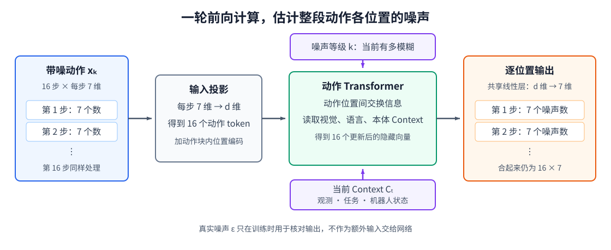

# 12-2 Diffusion 的生成：从噪声到动作块

12-1 节解决的是 **Diffusion 怎样训练**：给真实动作加噪，让网络练习估计加入的噪声。但是，训练结束时得到的只是一套会估计噪声的网络参数，并没有生成机器人要执行的动作。本节补上 Diffusion 的另一半——**怎样使用训练好的网络生成动作块**。实际使用时，先抽一整段随机噪声；网络在当前噪声等级估计这段动作中的噪声，采样器据此更新整段动作；如此反复，才得到一段候选动作。

这个生成过程需要分清两个部件：**去噪网络**负责回答“当前动作块里有多少噪声”，**采样器**负责依据这个回答和预设噪声日程，计算下一份噪声更少的动作块。下文先看网络在一次调用中怎样给出估计，再看采样器怎样多次调用它。一次网络前向计算并不等于完成整段动作生成。

## 1. 生成所需的噪声预测网络

设未来动作块有 16 步，每步 7 个连续数值。当前带噪块 $x_k$ 就是 $16\times7$ 的数组。先用一个可训练线性层把每一步的 7 个数映射成一个宽度为 $d$ 的向量，形成 16 个**动作 token**；这里的 token 仍是连续数值的内部表示，没有把动作量化成词表编号。给各 token 加上未来动作块内的位置编码，使网络区分“第 1 步”和“第 16 步”；另把噪声等级 $k$ 编成数字向量，告诉网络当前动作有多模糊。

经过第 10 章的 Context Model，视觉、语言和身体状态已成为情境向量或 token。一种设计让动作 token 用 Self-Attention 交换信息，再通过 Cross-Attention 读取情境；另一种设计把两组 token 放进同一网络，但要用注意力规则明确谁能读谁。无论选择哪种，动作位置要能利用当前情境和整段带噪动作：判断某一步的噪声可能依赖前后动作是否连贯。**这里不需要自回归地先生成第 1 步、再生成第 2 步**；全部 16 个带噪位置在这一轮同时存在，网络一轮输出全部位置的估计。

多层 Transformer 更新后，每个动作位置得到隐藏向量 $h_j$。同一组可训练输出参数应用在每个位置，把它映射回 7 个噪声数：

$$
\hat\epsilon_{\theta,j}=W_{\mathrm{out}}h_j+b_{\mathrm{out}},
\qquad j=1,\ldots,16.
$$

16 个位置合在一起，就是与 $x_k$ 同形状的 $16\times7$ 噪声预测。为什么输出层能预测噪声？不是它有“去噪公式”写在权重里，而是 12-1 节的损失逐项比较它与真实 $\epsilon$，梯度反复更新输入投影、Attention、时间条件和输出层。训练完成后，这些参数才可能把“此处看起来有哪些噪声”映射为数值。机器人动作模型 [Dita 原论文](https://openaccess.thecvf.com/content/ICCV2025/html/Hou_Dita_Scaling_Diffusion_Transformer_for_Generalist_Vision-Language-Action_Policy_ICCV_2025_paper.html)采用 Transformer 直接处理连续动作去噪；下图是一版便于学习的数据流，不宣称所有动作 Diffusion 模型都具有完全相同的注意力连接。

<figure markdown="span">
  { width="1120" loading=lazy }
  <figcaption>图 12-2　每步带噪动作先成为动作 token；噪声等级与 Context 提供条件；Transformer 更新整段动作表示；共享的输出层为每个位置给出与该步动作同维度的噪声估计。（本教程绘制）</figcaption>
</figure>

沿图 12-2 从左到右检查形状：输入 16 行、每行 7 个数，经过投影与 Attention 后仍对应 16 个动作位置，最后又回到 16 行、每行 7 个数。输出的第 $j$ 行只对应第 $j$ 步动作中的噪声，不是给整个动作块只预测一个标量，也不是直接把训练时的真实 $\epsilon$ 抄过来。**这张图只画了一次网络调用**：它提供当前等级的噪声估计，还没有说明随机动作怎样最终变成候选动作；下一节的采样器会反复使用这份估计。

## 2. 反向采样：从随机噪声得到动作块

实际使用时，真实未来动作 $x_0$ 尚未发生，不能像训练时那样从它构造 $x_k$。根据前向日程的末端设计，先抽取一份与动作块同形状的标准高斯样本 $x_K\sim\mathcal N(0,I)$。接下来不是逐步生成机器人要执行的第 1、2、3 步，而是**反复修改同一整段动作块**，让它从 $x_K$ 经过 $x_{K-1},x_{K-2},\ldots$ 走向 $x_0$。每轮都执行以下操作：

1. 把当前 $x_k$、等级 $k$ 和同一情境 $C_t$ 送入训练好的网络。
2. 得到整块动作的噪声估计 $\hat\epsilon_\theta(x_k,k,C_t)$。
3. 采样器结合这份估计与预先知道的噪声日程，算出噪声更少的 $x_{k-1}$。
4. 用新得到的 $x_{k-1}$ 继续下一轮，直到动作端。

可以先用“估计干净动作”理解第 3 步。把 12-1 节的加噪公式中的真实噪声换为预测值，可得

$$
\hat x_0=
\frac{x_k-\sqrt{1-\bar\alpha_k}\,
\hat\epsilon_\theta(x_k,k,C_t)}
{\sqrt{\bar\alpha_k}}.
$$

它表达了当前带噪动作减去估计噪声后，大致对应什么干净动作；**不表示一次计算就已得到可执行结果**。实际的 DDPM 采样器用已知日程走到前一个噪声等级，一种常见写法是

$$
x_{k-1}=
\frac{1}{\sqrt{\alpha_k}}
\left(x_k-\frac{\beta_k}{\sqrt{1-\bar\alpha_k}}
\hat\epsilon_\theta(x_k,k,C_t)\right)
+\sigma_k z,\qquad z\sim\mathcal N(0,I).
$$

括号中的校正由网络预测噪声和固定日程共同决定；$\sigma_k z$ 是这种采样方式在反向过程加入的随机项，常见 DDPM 最后一步不再加入。它不是训练时那份已知答案 $\epsilon$。第 3 步产生的 $x_{k-1}$ 是**下一轮网络的输入**，而非发送给机械臂的第 $k-1$ 个物理动作。反复更新的是整块未来动作数组；直到生成结束，才得到一个候选动作块。生成期间网络参数保持不变，变化的是送入网络的动作数组及当前噪声等级。

图 12-1 中向动作端返回的箭头，正对应这里的重复调用；前向加噪的随机数不会被保存下来按原顺序“减回去”。DDIM 等采样器可以改用不同的更新规则和较少的网络调用。采样步数少通常缩短等待时间，但动作质量是否足够，必须在同一动作定义和任务上测量，而不能凭方法名称判断。

## 配套实践：观察 Diffusion 怎样生成动作

实践 12-01 用二维点作为完整动作块的最小类比：同一 Context 下有上下两个合理模式。它先展示加噪等级增大时双峰如何逐渐模糊，再用小型 MLP 学习噪声预测，最后从新抽的随机点逐步生成条件样本。运行时要分清图中的“Noise step”是生成过程的等级，而二维坐标是动作数值；训练曲线下降只说明噪声估计改善，最终仍要看样本是否回到对应 Context 的两个有效区域。Notebook 不实现图 12-2 的完整动作 Transformer，但训练输入、噪声监督和采样循环与本节对应。

至此，12-1 节的“训练噪声预测网络”和本节的“调用网络逐步生成动作”才组成一条完整的 Diffusion 路线。12-3 节不是这条路线的下一道工序，而是解决**同一个动作生成问题**的另一种方法：Flow Matching 让网络预测中间动作应该怎样变化，再沿预测的速度生成动作。

[返回 12 导读](12-diffusion-and-flow-matching.md) · [继续阅读 12-3 Flow Matching](12-3-flow-matching.md)
