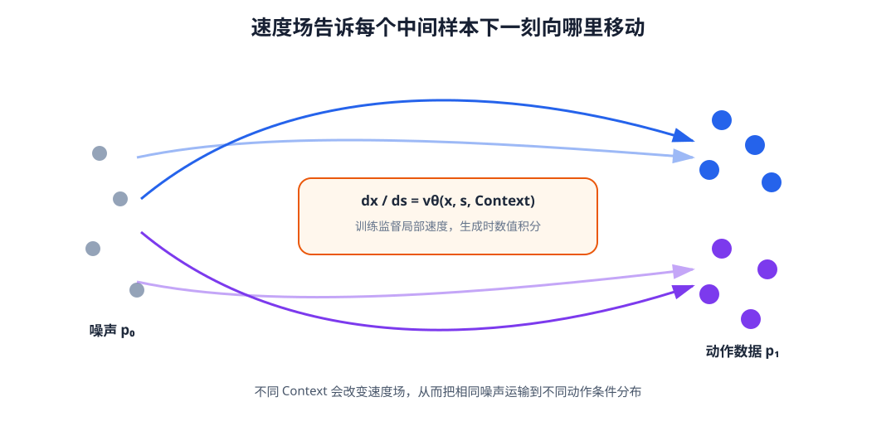

# 12-3 Flow Matching：学习从噪声到动作的速度

Diffusion 的训练题目是“这份带噪动作中加入了什么噪声”。Flow Matching（流匹配）换一个问题：把随机噪声逐渐变成一段示范动作时，**在当前中间位置应怎样改变整个动作块**？这种改变用生成进度上的“速度”表示。它不是机器人关节每秒转动多少弧度，而是动作数组随着生成进度变化的速率。本节先用一对数值造出训练题目，再把同一规则交给机器人动作 Transformer，最后看使用时如何反复积分。

## 1. 一对噪声和示范动作怎样产生训练题目

从示范数据取当前情境 $C_t$ 及其干净动作块 $a$，再独立抽一份同形状的标准高斯噪声 $z$。另选一个生成进度 $s\in[0,1]$：$s=0$ 指噪声端，$s=1$ 指动作端。最简单的路径是在这两个端点之间直线插值：

$$
x_s=(1-s)z+sa.
$$

例如，只观察动作块的一个横向分量。第一对端点是噪声 $z=-0.2$ 与一条左绕示范的数值 $a=-1$；第二对是 $z=0.2$ 与右绕数值 $a=1$。两条路径如下：

| 配对 | 进度 0：噪声端 | 进度 0.5：中间值 | 进度 1：动作端 | 这条路径的目标速度 |
|---|---:|---:|---:|---:|
| 第一对 | −0.2 | −0.6 | −1.0 | −0.8 |
| 第二对 | 0.2 | 0.6 | 1.0 | 0.8 |

中间值不是重新采集的机器人动作，而是由当次选中的两个端点计算出来。例如第一对在 $s=0.5$ 时，$x_s=0.5(-0.2)+0.5(-1)=-0.6$。沿**固定这一对端点**的直线，进度每增加一单位，数值变化 $a-z$，所以监督速度为

$$
v^*=\frac{d x_s}{ds}=a-z.
$$

对完整动作块，公式对每个未来时刻、每个动作维度同时成立。表中两对只是帮助看清线段：真实训练会不断重新抽示范、噪声和进度，负噪声并不“专属”左绕。想象在同一个进度上收集许多不同配对算出的中间动作：$s=0$ 时是一群噪声样本，靠近 $1$ 时逐渐呈现当前任务下的动作分布；这些**随进度变化的一群样本**就是此处所谓的概率路径，而不是某一条画出来的线。

## 2. 网络学的是当前位置的变化速度

训练程序知道本次选中的 $a,z,s$，所以能算出输入 $x_s$ 与正确速度 $a-z$。速度网络只接收当前中间动作 $x_s$、进度 $s$ 和情境 $C_t$，给出同形状的预测：

$$
\hat v=v_\theta(x_s,s,C_t),\qquad
\mathcal L_{\mathrm{FM}}=
\mathbb E_{(C_t,a),z,s}
\left\lVert \hat v-(a-z)\right\rVert_2^2.
$$

两个端点 $a,z$ 用来造训练题和答案，**不会再作为两个独立输入直接交给网络**。如果多条随机配对经过相近的中间位置，网络在平方误差下会学到那附近综合后的条件速度，而不必记住其中某一根训练线。一次参数更新只需要一个随机进度上的中间样本；下一批的 $s$ 可以比上一批小，训练并不是按 $s=0,0.1,\ldots,1$ 顺序走完整条路径。完整生成才需要沿进度连续调用网络。

二维动作的教学实验用多层感知机（MLP）已经足够展示这种监督。对完整机器人动作块，速度网络通常需要同时读取多个未来动作位置以及视觉、语言和身体状态，可以使用 Transformer。无论骨干是 MLP 还是 Transformer，它的输出形状必须与 $x_s$ 一样；若动作块为 16 步、每步 7 维，就要给出 $16\times7$ 个生成速度数值。

<figure markdown="span">
  { width="1080" loading=lazy }
  <figcaption>图 12-3　训练时从噪声和示范动作取一个中间点，并用两端之差监督此处的变化速度；使用时只给起始噪声，再反复查询网络更新整段动作。（本教程绘制）</figcaption>
</figure>

读图 12-3 时先区分“线”和“点”：一条线由一对随机端点确定，训练程序能在线上任选进度造出中间点；网络却只收到该点、进度和 Context，不会看到整条线的两端。许多配对共同训练的速度场，才在使用时引导**新抽到的噪声**向当前任务的动作分布移动。

## 3. 机器人动作专家：以 π₀.₅ 为例

为了知道“速度网络”在真实 VLA 中是什么结构，可沿 [π₀.₅ 论文](https://arxiv.org/abs/2504.16054)和 [OpenPI 官方实现](https://github.com/Physical-Intelligence/openpi/blob/main/src/openpi/models/pi0.py)看一次动作专家的数据流。以下仍用本教程的 $s=0$ 为噪声端、$s=1$ 为动作端；16 步、每步 7 维只是便于追踪形状的例子，并非 π₀.₅ 固定的动作规格。

训练样本先提供图像、任务语言、机器人状态和真实示范动作块 $a$。前几类输入经过视觉语言侧形成**情境前缀**；训练程序另外抽 $z$ 与 $s$，算出 $x_s$ 和答案 $a-z$。动作块每个未来位置的带噪数值经过可训练线性投影，成为一个动作 token；进度 $s$ 也编码成向量，作为动作专家各层处理当前噪声程度的条件。官方配置说明，π₀.₅ 的动作专家使用自适应 RMSNorm（均方根归一化）注入 Flow Matching 的进度信息；这个小型条件处理不是另一个替代 Transformer 的速度网络。[OpenPI 配置说明](https://github.com/Physical-Intelligence/openpi/blob/main/src/openpi/models/pi0_config.py)

动作专家主体是 Transformer。它让动作位置相互参考，并允许动作侧读取视觉、语言和状态形成的前缀；注意力规则不让前缀反过来读取这次送入的带噪动作。多层处理后，每个动作位置仍有一个隐藏向量，输出线性层把它映回该位置的动作维度。若教学例子是 $16\times7$ 的 $x_s$，输出也是 $16\times7$ 的速度预测，逐项与已知的 $a-z$ 比较。这与 12-2 节的动作 Transformer 有相似的“每个动作位置输出一组数”的结构，**但监督对象不同**：Diffusion 例子输出加入的噪声，π₀.₅ 的这一动作专家输出生成进度上的速度。

π₀.₅ 还包含其他视觉语言训练与推理环节，本节只隔离其连续动作专家来解释 Flow Matching；不能把这里的教学直线路径和均匀采样进度说成论文全部训练细节。官方实现对进度的取样和符号方向均有自己的约定，阅读源码时应以实际代码为准。

## 4. 使用时沿学到的速度场更新

使用时没有真实示范动作 $a$。先根据当前观测形成 $C_t$，为整块动作抽取一次起始噪声 $x(0)=z$；随后反复输入当前动作块、当前进度和同一情境，让网络给出速度。最简单的 Euler 更新为

$$
x(s+\Delta s)\approx x(s)+
\Delta s\,v_\theta(x(s),s,C_t).
$$

假设分成十段，则从 $s=0$ 开始每轮增加 $0.1$，更新后的整个动作块成为下一轮输入；到 $s=1$ 才得到候选动作。连续写法是 $dx/ds=v_\theta(x(s),s,C_t)$。推理期间网络参数不更新，也不在每个积分步重新抽起始噪声。生成轨迹走的是网络综合许多配对学到的速度场，未必重走训练集某一条直线。

对照 OpenPI 源码时，要小心方向相反：实现采用 $\tau=1$ 为噪声端、$\tau=0$ 为动作端，构造 $x_\tau=\tau z+(1-\tau)a$，目标速度是 $z-a$，生成时从 $\tau=1$ 向 $0$ 积分。令本教程的 $s=1-\tau$，就回到 $x_s=(1-s)z+sa$ 与速度 $a-z$；这是**同一路径换了进度方向**，不是两个不同算法。

实践 12-02 在与 Diffusion 实践相同的二维双峰任务上训练小型 MLP。它先画出少数随机配对的直线与中间点，再画训练损失和从新噪声出发的粒子运动。Notebook 把噪声端记作“x0”、数据端记作“x1”；不要与 Diffusion 的“$x_0$ 是干净动作”混淆。运行第一幅图时，绿色中间点只属于当次画出的那条配对线；下一训练批次会重新抽动作、噪声和进度，不要求进度单调增加。

训练得到的只是一种候选动作生成器。下一节把它与 Diffusion 放在同一接口下比较，并检查候选动作能否在真实物理单位中安全、及时地使用。

[返回 12 导读](12-diffusion-and-flow-matching.md) · [继续阅读 12-4 生成动作的约束与评价](12-4-action-generation-in-robotics.md)
