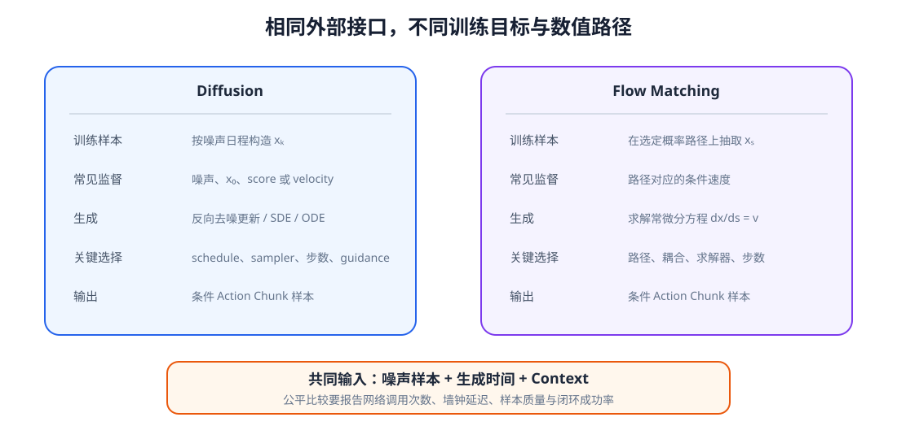

# 12-4 生成动作的约束与评价

12-2 节的去噪采样器和 12-3 节的速度场积分，最后都能给出一个与动作块同形状的数组。但一个“看起来像示范”的数组，还不能直接交给机器人：它可能是归一化数值，可能超出关节范围，也可能在两次控制命令之间跳得太远。本节先对齐两种生成方法的输入和输出，再用同一个机械臂例子检查候选动作，最后讨论怎样评价生成质量。

## 1. 两种生成方法怎样接到同一个动作接口

第 10 章给出的 Context $C_t$ 包含当前任务、观测和历史，第 11 章规定了动作块的含义。因而无论内部使用哪种生成方法，对外都可以要求：输入当前 $C_t$，输出一段长度为 $H$、每步 $D_a$ 维的候选动作。这不意味着内部训练过程相同。

| 要核对的环节 | Diffusion（12-1、12-2 节） | Flow Matching（12-3 节） |
|---|---|---|
| 训练时给网络什么 | 带噪动作 $x_k$、噪声等级 $k$、Context | 中间动作 $x_s$、生成进度 $s$、Context |
| 用什么作为答案 | 当次加入的噪声 $\epsilon$ | 当次配对的动作与噪声之差 $a-z$ |
| 使用时怎样开始 | 为整块动作新抽一份噪声 | 为整块动作新抽一份噪声 |
| 使用时怎样更新 | 用噪声估计和采样规则逐级减少噪声 | 用速度估计和积分规则逐步移动动作 |
| 对外得到什么 | 一个连续数值动作块 | 一个连续数值动作块 |

<figure markdown="span">
  { width="1100" loading=lazy }
  <figcaption>图 12-4　两条路线都从随机噪声生成动作块，但 Diffusion 学习噪声估计，Flow Matching 学习生成进度上的变化速度。图中的进度不是机器人执行动作的时间。（本教程绘制）</figcaption>
</figure>

图 12-4 的两条路线在输出端汇合：它们都要服从同一套动作定义和后续执行规则。这里还要区分两种时间。$k$ 或 $s$ 描述**生成过程进行到了哪里**；动作块内的第 1、2、…、$H$ 步则描述**机器人未来何时执行**。一个生成进度上的更新会同时改变整段未来动作，并不等于机器人已经执行了一步。

条件也必须在生成时真正起作用。若 Context 是一组视觉、语言和本体 token，动作网络可以用 Cross-Attention 读取它们；若已压缩成一个向量，也可以把它送入网络各层。换了目标物体或障碍位置，输出分布应相应变化。比较两种方法所需的时间时，至少记录一次决策调用网络多少次、完成生成实际耗时多少，以及是否达到了相近的动作质量；不能只按“Diffusion”或“Flow Matching”的名称断定哪一个更快。

## 2. 从模型数值到合法控制命令

先明确动作的**控制语义**。以下仅讨论“每一步给某关节一个绝对角度目标”，而不是关节速度或末端位姿。若模型训练时把角度归一化，必须用训练时固定的均值与尺度还原成弧度，再按物理单位检查。归一化数值 $0.8$ 不能直接与机械臂手册中的 $1$ 弧度上限比较。

假设某关节允许角度为 $[-1,1]$ 弧度，控制周期为 $0.1$ 秒，最大速度为 $0.5$ 弧度每秒。执行前实测角度是 $0.16$ 弧度，生成动作块前三步的目标角度是 $0.20$、$0.24$、$1.10$ 弧度。每步允许的最大变化是 $0.5\times0.1=0.05$ 弧度，所以前两步的变化 $0.04$ 都合格；第三步既超过位置上限，也不满足速度限制。

把第三步直接裁剪到上限 $1.00$ 弧度仍不合格：从 $0.24$ 到 $1.00$ 弧度，$0.1$ 秒内需要移动 $0.76$ 弧度，对应 $7.6$ 弧度每秒。只看速度，第三步应落在 $[0.19,0.29]$ 弧度，再与位置范围求交集。因而原预测的 $1.10$ 不可能靠一次简单的限幅变成原意不变且可执行的动作；可以拒绝候选并重新生成，或者由约束处理器重新规划，并重新检查后续各步。

位置和速度合格仍不等于动作安全。若还有限制加速度，就要比较相邻两步速度的变化；整组关节也可能形成连杆碰撞。夹爪开合往往是离散控制，不能把“开”和“关”直接平均成控制器不支持的中间命令。因此检查规则必须按动作通道的语义分别建立，不能对所有数值统一裁剪或平滑。第 13 章会把这种检查放进生成后的执行流程。

## 3. 怎样判断生成结果对任务有用

首先不要只对照**一条**示范计算平方误差。假设绕开杯子的左路线和右路线都能成功，分别用 $-1$ 和 $+1$ 表示，而测试集刚好只录了 $+1$。模型给出另一条可行路线 $-1$，平方误差为 $4$；给出直冲杯子的中间路线 $0$，平方误差反而只有 $1$。数值更接近录下的示范，不代表机器人更可能成功。

因此，对同一个测试情境要多次采样，并把“能否覆盖不同可行路线”和“每条候选是否有效”分开统计。例如抽取 20 段：8 段有效左绕、8 段有效右绕、4 段碰撞或越界。模型覆盖了两种路线，但有效候选只有 $16/20=80\%$。若把障碍放到杯子右侧，右绕不再可行；这时重新采样，观察模型是否转向左绕，才能检验它是否利用了新的 Context。统计越界时，还应分清原始生成结果和后处理结果：裁剪后不越界，并不说明生成模型自己学会了边界。

最后要在闭环任务中执行。保持初始场景、底层控制器和候选选择规则一致，记录完成次数、碰撞或抓取失败的原因，以及从取得观测到动作就绪的完整耗时。只测一次网络前向时间，会漏掉多次生成更新、约束检查和候选选择；若完整计算来不及在下一次控制决策前结束，离线样本再漂亮也无法稳定使用。这些指标各回答一个问题：**能否生成可行动作、能否随情境改变、能否完成任务、能否及时给出命令**。

## 本章小结与下一章

Diffusion 和 Flow Matching 为同一个动作接口提供两种训练与生成路线：前者学习估计所加噪声，后者学习沿路径移动的速度。两者都需要将生成结果还原到物理单位，再按机器人控制语义验证，并在相同任务中评价，而不能把噪声预测误差或速度拟合误差直接当成任务成功率。

至此，第 12 章回答了“候选动作怎样产生”。下一章将接着回答：拿到一个或多个候选动作块以后，Action Model 怎样安排生成、选择和执行，机器人又应在什么时候重新读取观测？

[返回 12 导读](12-diffusion-and-flow-matching.md) · [继续阅读第 13 章](13-generative-action-model.md)
