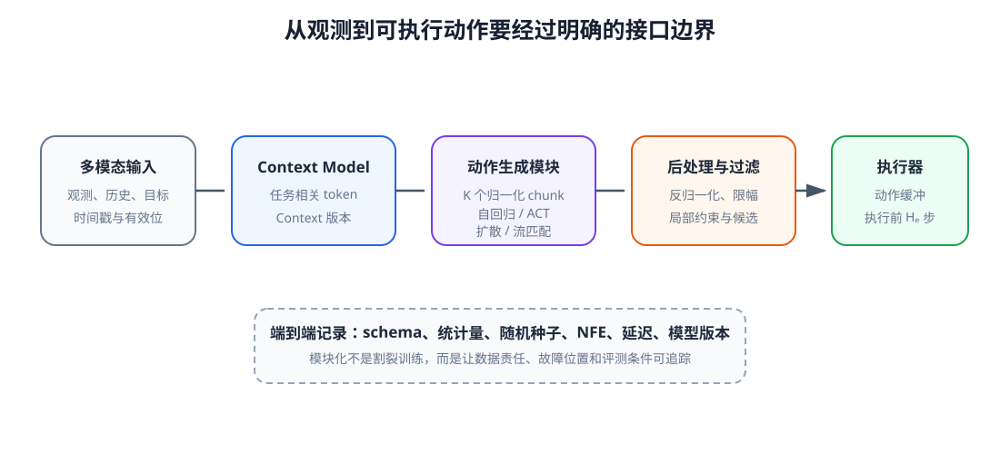
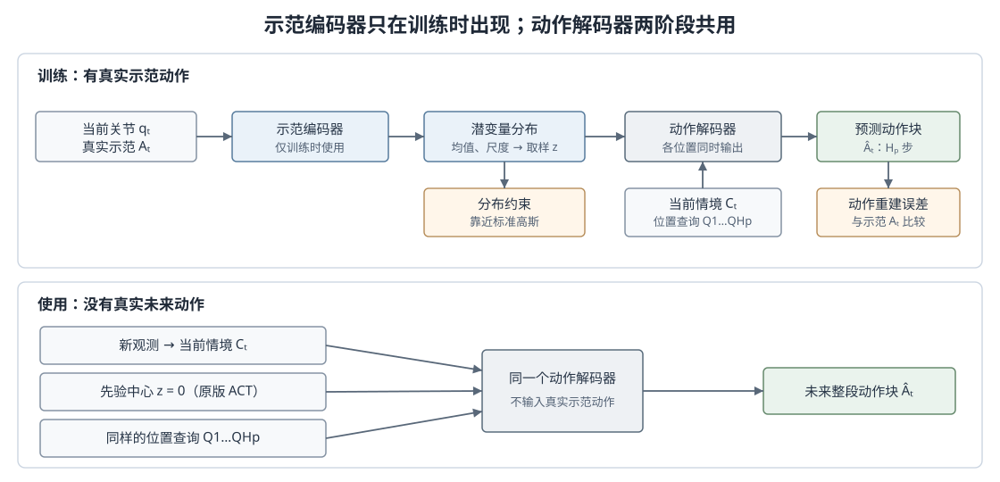

# 13-1 Action Model 的组成与动作专家

第 10 章把多模态观测和历史整理成 Context，第 11 章规定了动作块的含义，第 12 章介绍了 Diffusion 与 Flow Matching 怎样生成连续动作。但“会生成一段数值”还不等于“机器人能执行这段动作”。第 13 章要把这些环节接成完整的 Action Model。本节先划清模块职责，再比较几种动作生成方法怎样产生同一种动作块；下一节才把它们的输出交给统一接口和执行器。

## 1. 从 Context 到可执行候选动作

在本教程中，Action Model 是从机器人输入到可执行动作候选的整条链，而不只是其中的神经网络。它至少包含三个相继的计算环节：Context Model 从当前观测、历史动作和任务目标形成情境；**动作生成模块**根据情境产生归一化的候选动作块；后处理器把动作恢复为物理命令并检查能否执行。这里按功能命名“动作生成模块”，不把某个具体模型中的 Action Expert 当作所有生成方法的通用名称。

$$
C_t=\operatorname{ContextModel}_\psi(o_{t-H:t},a_{t-H:t-1},g),
$$

$$
\tilde A_t^{(k)}\sim\operatorname{ActionGenerator}_\theta(\tilde A\mid C_t),
\qquad
A_t^{(k)}=\operatorname{Postprocess}(\tilde A_t^{(k)},S_a).
$$

这里的 $o_{t-H:t}$ 是截至当前的观测历史，$a_{t-H:t-1}$ 是此前动作，$g$ 是任务目标；$\psi$ 与 $\theta$ 是 Context Model 和动作生成模块的参数。式中的 ActionGenerator 仅是“动作生成模块”的功能记号，不指定自回归、ACT 或扩散等内部实现。波浪号表示模型使用的归一化数值，$k$ 表示第几条候选。$S_a$ 是动作定义及其统计量，例如每个分量的单位、均值、尺度和允许范围。后处理完成后，底层控制器才跟踪最终选中的动作。若原始输入有误、候选动作无效，后处理也不能凭空修复模型没有学会的任务行为。

<figure markdown="span">
  { width="1100" loading=lazy }
  <figcaption>图 13-1　Context Model 组织任务条件，动作生成模块产生归一化候选，后处理器恢复物理语义并过滤明显无效动作，执行器只消费选中动作块的前缀。（本教程绘制）</figcaption>
</figure>

沿图 13-1 从左到右看，每个模块回答不同问题：Context Model 判断“当前是什么任务和状态”，动作生成模块提出“接下来可以怎样运动”，后处理器判断“这些数值是否符合机器人的动作定义与约束”。若目标理解错误，首先检查 Context；若模型始终不会生成一种合理绕行，检查动作生成模块；若角度单位写错或命令超速，检查动作定义与后处理。第 13-2 节会具体展开后两者怎样交接。

## 2. 三类动作生成方法怎样产生整段动作

沿用第 11 章的记号，动作生成模块要产生未来 $H_p$ 步动作块 $A_t=[a_t,\ldots,a_{t+H_p-1}]$。以“绕开杯子”为例，同一观测下从左侧和右侧绕行都可能合理。以下三类方法都以 $C_t$ 为条件，区别在于**一段动作内部按什么顺序形成**，不是最终动作的单位不同。

### 自回归：用已生成的前缀决定下一步

自回归方法把整段动作的条件分布分解为

$$
p(A_t\mid C_t)=\prod_{h=0}^{H_p-1}
p(a_{t+h}\mid a_{t:t+h-1},C_t).
$$

$h$ 是动作块内的位置。生成第一步时只看 $C_t$；生成第二步时，再看自己刚生成的第一步，依次走到块末。训练时可以把示范中的真实前缀提供给模型，以便同时计算各位置的误差；实际使用时没有真实未来动作，只能逐步使用自己的输出。如果最初一步朝错误方向运动，后续预测便可能沿这个错误前缀继续。连续动作可直接预测每步数值的分布，也可先编码成离散动作 token；无论哪种，都要还原为第 11 章规定的动作语义。

### ACT：让多个动作位置同时读取情境

ACT（Action Chunking with Transformers）为未来每个位置准备一个查询向量，让解码器一次输出整段动作，而不是先生成第一步、再把它送回网络生成第二步。它常与 CVAE（Conditional Variational Autoencoder，条件变分自编码器）一起训练，用内部潜变量 $z$ 表达同一情境下不同示范动作的变化。先分清**训练时**和**实际使用时**的两条数据流，潜变量的来源才容易理解。[ACT 原论文](https://arxiv.org/abs/2304.13705)

<figure markdown="span">
  { width="1120" loading=lazy }
  <figcaption>图 13-2　上半部：真实示范进入训练专用编码器，得到潜变量 z；解码器依据当前情境、z 和动作位置查询重建整段示范。下半部：使用时没有未来示范，编码器退出，解码器从约定的潜变量取值生成动作。（根据 ACT 论文绘制）</figcaption>
</figure>

先看图 13-2 上半部。训练样本包含当前状态与后续一段真实动作 $A_t$。原版 ACT 的示范编码器读取**当前关节状态 $q_t$ 与真实动作块 $A_t$**，推断潜变量 $z$ 的分布；图像则走动作解码器一侧。可以把 $z$ 理解为解码器能读取的一组内部数值，用来区分示范中的不同动作变化，而不是传感器测到的物理量。例如同一杯子情境下，两段四步横向示范分别为 $(-0.1,-0.2,-0.3,-0.4)$ 和 $(0.1,0.2,0.3,0.4)$。编码器看到的是两段数值，并未得到“左绕”“右绕”的人工标签；它为每段示范算出潜变量分布的均值与尺度，训练时再从中取 $z$。不同 $z$ 有机会帮助解码器重建不同动作，但不保证某一维天然表示“左”或“右”。

图中训练和使用共用的解码器接收当前图像与机器人状态形成的情境、潜变量 $z$，以及 $H_p$ 个动作位置查询 $Q_1,\ldots,Q_{H_p}$。$Q_j$ 告诉解码器“这里需要动作块第 $j$ 步”，它不是这一步的真实动作，也不是监督标签。原论文使用固定位置编码作为这些查询。各位置查询读取情境和 $z$，再经输出层变成动作数值：

$$
\hat A_t=\operatorname{Decoder}_{\theta}(C_t,z,Q_1,\ldots,Q_{H_p}).
$$

预测四步、每步七维时，四个位置各输出七个数，合起来为 $4\times7$ 的动作块。第 2 步的查询不需要等第 1 步生成完毕，这正是它与自回归方法的区别。

训练有两项要求。第一项比较预测块 $\hat A_t$ 与真实示范 $A_t$，使解码器学会重建动作；原版 ACT 使用逐项绝对误差。第二项使示范编码器输出的潜变量分布接近事先约定的标准高斯 $\mathcal N(0,I)$。这样使用时即使看不到未来示范，也能从已知分布取得 $z$。约束过强时解码器可能忽略 $z$；过弱时实际取到的 $z$ 又可能落在训练时很少见的区域。

再看图 13-2 下半部。机器人实际运行时只有当前观测，**没有未来真实动作块**，示范编码器因此退出。原版 ACT 固定取标准高斯先验的中心 $z=0$，让同一个解码器依据当前情境和位置查询输出整段动作。其他实现也可以从先验抽取多个 $z$ 尝试不同候选，但原版的默认做法并非如此，随机抽取也不保证一定得到左右两种绕法。

### Diffusion 与 Flow Matching：反复更新整段动作

第 12 章的两种方法也以 $C_t$ 为条件，却先抽取一整块噪声。Diffusion 的网络估计噪声并让采样器逐级更新动作；Flow Matching 的网络估计生成进度上的速度并沿速度场积分。**每一次更新作用于整段动作块**，而不是自回归地只生成下一个物理时刻。对同一情境换一份起始噪声，就可能得到另一条候选；反复调用网络通常需要计入较长的决策时间，能否减少生成步数仍需用动作质量检验。

三类方法的区别可以概括为：自回归逐位置生成，ACT 同一次解码生成整块，Diffusion 或 Flow Matching 多次更新整块。第 13-2 节不再依赖这些内部步骤，而只规定它们最终交出的动作块长什么样、代表什么物理命令。

[返回 13 导读](13-generative-action-model.md) · [继续阅读 13-2 统一接口与滚动执行](13-2-action-interface-and-execution.md)
