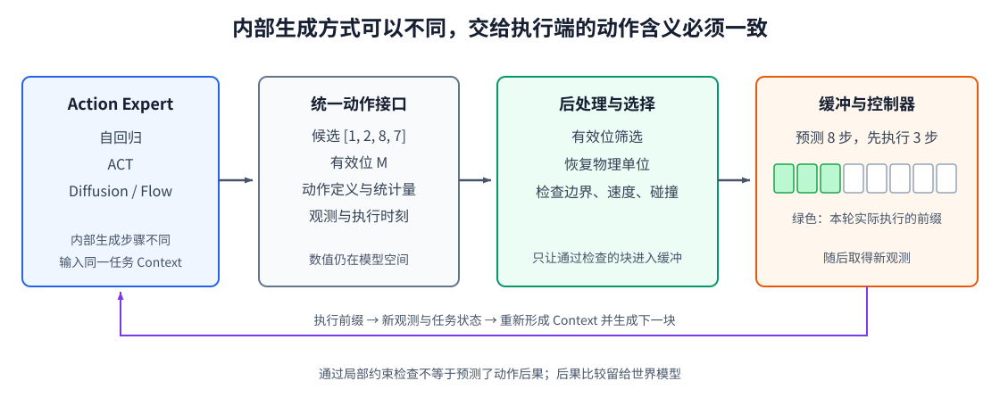

# 13-2 统一动作接口与滚动执行

13-1 节比较了三类动作专家的内部生成过程。控制器却不应该因专家从左到右生成、一次解码，还是多次修改噪声，就使用三套不同的命令解释方式。为了把专家与机器人执行端接起来，本节先明确统一接口中的每个数和每个维度，再看候选如何通过检查、进入缓冲区，以及为什么只执行动作块的一部分。

## 1. 统一接口首先统一动作含义

调用专家时给出当前 Context、希望生成的候选数、预测长度和动作定义。动作定义来自第 11 章的数据契约：每一步有几个分量，各自对应哪个关节或夹爪，是位置还是速度命令，使用什么单位与控制频率。仅有相同的张量形状并不足以互换模型；同样的数值 $0.2$，在关节位置和关节速度接口中就不是同一条命令。

设一次处理 $B=1$ 个情境；Context Model 为这个情境输出 $N_c=128$ 个 token，每个 token 有 $D=256$ 个特征，于是输入 Context 的形状为 $[B,N_c,D]=[1,128,256]$。$B$ 是这次同时处理几个情境，$N_c$ 是每个情境有几个 Context token，$D$ 是每个 token 的特征维数。若某个 Context Model 只给一个向量，也可以将它视作一个 token，或在专家入口转换；**统一接口不要求所有模型都输出 128 个 token**。

假设每个情境需要 $K=2$ 条候选，每条预测 $H_p=8$ 个控制周期，每步有 $D_a=7$ 个动作数值。无论专家内部怎样生成，对外都整理为

$$
\tilde A_t\in\mathbb R^{B\times K\times H_p\times D_a}
=\mathbb R^{1\times2\times8\times7}.
$$

四个维度从左到右分别回答：哪个情境、哪条候选、未来第几步、这一步的哪个动作分量。另附同形状的**有效位** $M_t$：有真实动作定义的位置为 1；末尾补齐的时间步或当前机器人不存在的分量为 0。后处理器不能把补齐的 0 当成“让关节回到零位”。有效位只说明该位置是否有动作数据，**不说明这条候选已经安全**。

候选数 $K$ 也不意味着必须人为复制动作。自回归模型可以分别采样两次；Diffusion 和 Flow Matching 可以从两份起始噪声生成；ACT 的某些用法可以取不同潜变量。若某个 ACT 实现固定使用同一个潜变量中心，同一情境只得到一条确定结果，就如实设 $K=1$。统一的是动作的排列和语义，不是强迫所有专家产生同样的多样性。

## 2. 生成结果怎样变成可检查的命令

接口除了动作数值，还要写清楚**依据哪次观测生成、计划从哪个控制时刻开始执行**。若结果到达时对应的执行时刻已过去，控制器不能把它当作新动作。动作定义和归一化统计也要与训练时一致：训练若用“七维关节位置规范 A1”的均值、尺度和单位，部署就必须用同一套 A1 还原。随机种子、模型标识和生成耗时可用于复现实验与定位问题，但它们不是关节角本身，也不能替代单位信息。

<figure markdown="span">
  { width="1120" loading=lazy }
  <figcaption>图 13-3　不同动作专家统一交出候选动作与有效位；后处理器按动作定义还原物理单位并检查约束；通过检查的动作块进入缓冲区，控制器只执行选中块的一小段。（本教程绘制）</figcaption>
</figure>

沿图 13-3 读，一条候选先经过有效位筛选，再按训练时统计量反归一化，最后按动作的**物理语义**检查。若第七个分量代表夹爪开度，它不能被当作第七个关节角；若是关节位置目标，就要检查边界、相邻命令所需速度以及已知障碍。第 12-4 节已用数值说明：只把越界目标裁到关节上限，仍可能造成超速。后处理不是凭空保证任务成功，只能先过滤明显不可执行的命令。

设两条候选分别从杯子左侧和右侧绕过。右侧轨迹若立即越界，可在这一层被拒绝；左侧轨迹若通过约束，才进入可执行候选。若两条都合法，本层却不能仅凭当前位置判断哪条推完后更接近目标；那需要预测候选造成的后果，留待高级篇的世界模型。自回归 token 概率、ACT 潜变量数值或扩散模型训练误差也不能直接当成“这条候选会成功”的概率。没有额外的可靠评价方法时，先把候选当作**待检查的建议**，而不是已经按任务好坏排好序的方案。

## 3. 只执行前缀，再用新观测生成下一块

第 11 章区分预测长度 $H_p$ 和执行长度 $H_e$。例如模型预测未来 $H_p=8$ 步，控制器只执行前 $H_e=3$ 步，然后读取新观测，再生成新的八步。这样既能利用整段预测保持局部动作连贯，也能在物体移动或接触状态改变后修正计划。这称为**滚动时域控制**：计划的起点不断随真实执行向前移动，而不是一次性把八步全部交给机器人。

执行器通常每隔固定控制周期取出下一条命令，专家却需要一定时间生成新动作。两者之间用**动作缓冲区**保存已经通过检查、安排好执行时刻的命令。只要缓冲里还有动作，控制器就无需因新块仍在计算而停下；如果缓冲用尽而新块未到，则必须采用预先设计的保持或停止行为，不能发送一个不存在的动作。第 13-3 节将用时间线具体说明旧块执行期间新块如何生成、何时能够接管，以及 RTC 怎样减小接管处的不连续。

## 配套实践：让不同专家使用同一接口

实践 13-01 用四个可控的简化专家模拟自回归、ACT 风格整块解码、Diffusion 去噪和 Flow 积分。它们不是这些算法的完整复现，而是刻意保持相同的候选形状和动作含义，以便在同一绕障任务上比较模式覆盖、碰撞通过率、动作连续性及网络调用次数。运行前先核对每个数组维度与本文的 $B,K,H_p,D_a$ 对应什么；运行后再看：某种方法生成了不同轨迹，是否就意味着这些轨迹都能通过约束检查？

[返回 13 导读](13-generative-action-model.md) · [继续阅读 13-3 推理延迟与动作块衔接](13-3-realtime-action-chunking.md)
