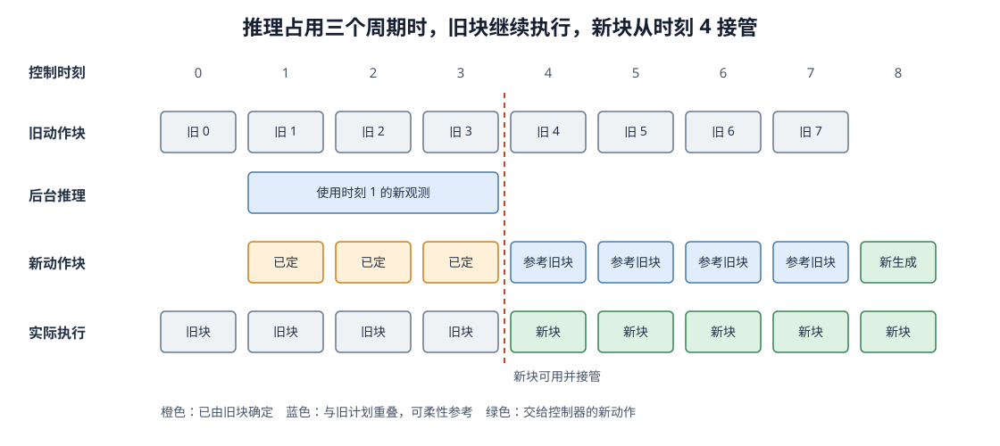

# 13-3 推理延迟与动作块衔接

13-2 节说明机器人可以预测一段动作、只执行前面几步，然后根据新观测再次生成。但“重新生成”并非瞬间完成：控制器仍以固定周期发送命令，新动作块却可能要等几个控制周期才能算出来。本节用一条具体时间线区分两个问题：**等待期间谁提供命令**，以及**新块到达后怎样接住旧块**。前者依靠动作缓冲和安全回退，后者可以利用实时动作块衔接方法 RTC。最后再沿整条控制流程评价 Action Model。

## 1. 模型计算期间，控制器仍需要动作

设控制周期为 $0.1$ 秒，旧动作块已经通过约束检查，安排了控制时刻 $0$ 到 $7$ 的命令。机器人执行到时刻 $1$ 时取得新观测，并开始生成下一块；如果生成耗时三个控制周期，控制器仍需要按时执行时刻 $1、2、3$ 的命令。动作缓冲保存旧块尚未执行的命令，因此机器人不会因为模型还在计算就立即断档。

缓冲解决的是**命令有没有按时到达**，不自动解决**新块的开头与当前运动是否连贯**。当新块在时刻 $4$ 到达时，它依据时刻 $1$ 的观测生成；新块中对应时刻 $1、2、3$ 的位置已经过去，不能从第一个位置重新执行。若新块剩余部分突然指向相反方向，即使每个动作分量都在边界内，接管处仍可能产生急剧变化。模型计算过久、旧块也已用尽时，则必须启动事先定义的保持或停止策略，不能执行空缓冲或已过期的结果。

## 2. RTC 怎样使新块接续正在执行的动作

RTC（Real-Time Chunking，实时动作块衔接）用于生成下一动作块时处理上述接管问题。它针对扩散或流模型：机器人继续执行旧块的同时，在后台根据新观测生成新块；生成过程利用旧块中**已经确定的动作**约束新块对应位置，并在尚未执行的位置产生后续动作。它不是把两段最终动作简单拼在一起，也不是重新训练一套速度网络。[RTC 原论文](https://arxiv.org/abs/2506.07339)

<figure markdown="span">
  { width="1120" loading=lazy }
  <figcaption>图 13-4　时刻 1 取得新观测并启动生成；旧块在等待期间继续执行，新块到时刻 4 才可用。新块前三个位置对应已由旧块承担的时刻，不能再次执行；从时刻 4 起才可能接管。（本教程绘制）</figcaption>
</figure>

读图 13-4 时始终沿同一个**绝对控制时刻**向下对照。第一行是旧块覆盖的时刻；第二行显示新块从时刻 1 开始的推理占用了三个周期；第三行把新块的位置也对齐到时刻 1：前三个橙色位置对应已经由旧块承担的时刻 $1、2、3$，不能在时刻 4 才补执行。第四行才是真正发给机器人控制器的命令——时刻 $0$ 至 $3$ 来自旧块，从时刻 $4$ 起才使用新块。图中的虚线是接管点，不是第二次观测。

RTC 在**生成新块的过程中**利用这段已确定的前缀。以流模型为例，动作生成仍从整块噪声开始，多次调用第 12 章的速度网络；同时加入约束或引导，使新块中与已执行动作对齐的位置符合旧块，再生成与此前缀连贯的剩余部分。与旧计划重叠但尚未执行的时刻 $4$ 至 $7$，可以在接近接管点的地方较多参考旧计划，在更远处逐渐放松参考，让新观测有机会改变路线。这种参考并非逐项平均两条最终轨迹：若旧计划左绕，新观测却显示左侧出现障碍，直接平均左绕和右绕可能反而指向杯子。

RTC 解决的是生成与执行的**时间衔接**，不保证任务目标正确，也不取消 13-2 节的物理约束检查。如果新块晚到超过旧块有效长度，或者到达时观测已经过时，执行器仍须按照安全规则处理。论文是在使用阶段对已有扩散或流策略施加生成引导；它以 $\pi_{0.5}$ 等策略验证效果，不表示这些基础策略在原本训练时就内置了 RTC。第 11 章提到的时间集成则是对同一执行时刻的多次预测进行加权平均，虽然也能减小接缝，但不能保证平均出的动作一定有效。

## 3. 怎样评价完整 Action Model

现在可以沿 13-1 和 13-2 节建立的完整数据流比较方法。先固定任务场景、Context 输入、动作单位、训练与测试划分、预测长度、实际执行长度和后处理规则。否则某模型看起来更好，可能只是因为它获得了不同观测或使用了更宽松的动作边界。然后依次回答三个问题：**候选是否有效、闭环能否完成任务、动作能否按时交出**。

候选有效性要在同一个测试情境下多次生成，统计是否越界、碰撞，以及是否覆盖左绕和右绕等已知可行方式。只计算与一条示范的数值误差可能误导：若示范只录了右绕 $+1$，模型生成同样成功的左绕 $-1$ 会得到较大误差；预测中间的 $0$ 数值误差反而较小，却可能撞上杯子。离线误差可以帮助发现单位错误，不能代替动作有效性判断。

闭环表现要让机器人在相同初始条件下完整执行任务，报告成功次数和总次数，并记录碰撞、抓取失败、超时等原因。例如 30 次中成功 24 次应写成“24/30”，不只报 80%。还应改变物体位置或障碍后复测，以检验新观测是否真的进入动作决策。

时效性则从**取得观测**开始计时，直到候选生成、约束检查和选择全部结束，而不只量神经网络的一次前向计算。若控制周期为 $0.1$ 秒、缓冲只剩三步，下一块可用的时间约为 $0.3$ 秒。把 100 次完整决策耗时排序，第 95 个附近的数称为 95 百分位耗时：它说明大约 95% 的决策不比这个数更慢，但仍有较慢的决策可能让缓冲耗尽。还应直接报告“超过可用时间的次数/总次数”。自回归逐步生成、ACT 一次解码、Diffusion 与 Flow 多次更新，都会以不同方式影响完整耗时；方法名称本身不能代替测量。

实践 13-02 模拟控制器与较慢的策略线程，比较阻塞推理、异步缓冲和对过期结果的处理。先观察“只要旧缓冲仍有动作，控制器能否继续按周期执行”；再观察“新结果晚到时，为什么不能不核对时刻就直接接管”。本实验建立理解 RTC 的时间线，**没有实现 RTC 的生成引导**，因此不能用它证明 RTC 本身的效果。

## 4. 从动作生成走向未来预测

进阶篇至此建立了完整行动链：从观测和历史形成 Context，让不同动作生成模块交出相同语义的候选，经过物理检查后进入缓冲，只执行一段再观察；推理耗时较长时还要处理新旧动作块的接管。这个接口可以概括为

$$
\{A_t^{(1)},\ldots,A_t^{(K)}\}
\sim\operatorname{ActionModel}(o_{\le t},a_{<t},g).
$$

但如果左绕、右绕两条候选都满足当前关节和速度约束，以上流程仍无法告诉机器人：**执行以后杯子会到哪里，哪条更接近任务目标？** 生成模型的内部概率和局部边界检查都不能直接回答动作后果。高级篇将从真实交互中的“当前状态、实际动作、下一刻变化”出发，引入动作条件世界模型，让对未来的预测参与行动判断。

[返回 13 导读](13-generative-action-model.md) · [进入高级篇第 14 章](../advanced/14-action-conditioned-world-model.md)
