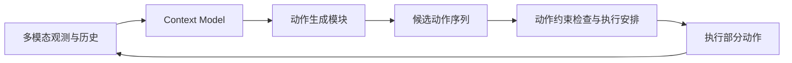

# 进阶篇：机器人怎样构建上下文并生成动作

基础篇已经建立视觉、语言、三维目标、本体、触觉和动作的数据接口。进阶篇通过两个单元研究：模型怎样从当前观测和历史中形成任务上下文，以及怎样利用这一上下文生成动作，并与机器人执行环节连接起来。

进阶篇最终形成下面的闭环：

在本教程中，Context Model 与动作生成模块共同组成 Action Model 的学习部分。Context Model 回答“机器人现在处于什么情境”，动作生成模块回答“在这种情境下可以怎样行动”。执行环节检查动作的物理语义与约束，只执行动作块的一部分，再根据新观测更新动作。这里还没有用世界模型预测候选动作的后果。

## 单元一：从当前观测到任务上下文

| 章节 | 要解决的问题 | 状态 |
|---|---|---|
| [08 时间与记忆](08-time-and-memory.md)（[08-1](08-1-temporal-sequences.md) · [08-2](08-2-rnn.md) · [08-3](08-3-lstm.md) · [08-4](08-4-gru-and-comparison.md)） | 从时间序列样本出发，分别理解 RNN、LSTM 与 GRU 的记忆更新 | 四个小章、图示与两份 Notebook 已完成 |
| [09 Attention 与 Transformer](09-attention-and-transformer.md) | 从[基本计算](09-1-attention-calculation.md)、[时间位置与 mask](09-2-position-and-masks.md)、[注意力接口](09-3-attention-interfaces.md)到[完整架构](09-4-transformer-architecture.md)，学习怎样读取与更新历史 | 四个小章、图示与两份 Notebook 已完成 |
| [10 多模态 Context Model](10-multimodal-context-model.md) | 从[时间对齐与 token](10-1-time-alignment-and-tokens.md)、[Context 构建](10-2-multimodal-fusion.md)到[训练与验证](10-3-context-training-and-validation.md)，形成供动作模型使用的任务条件 | 三个小章、图示与两份 Notebook 已完成 |

单元一的产物是

$$
C_t=\operatorname{ContextModel}(o_{\leq t},a_{<t},g).
$$

它不是动作，也不是未来预测，而是后续模型共同使用的任务相关上下文。

## 单元二：从示范动作到生成式 Action Model

| 章节 | 要解决的问题 | 状态 |
|---|---|---|
| [11 从示范到动作序列](11-demonstrations-to-action-sequences.md) | 从[示范与动作标签](11-1-demonstrations-and-action-labels.md)、[行为克隆](11-2-behavior-cloning.md)、[动作块执行](11-3-action-chunk-execution.md)到[多种合理动作](11-4-multimodal-actions.md)，建立第一个 Action Model 并看清单值预测的局限 | 四个小章、图示与两份 Notebook 已完成 |
| [12 Diffusion 与 Flow Matching](12-diffusion-and-flow-matching.md) | 从[Diffusion 训练](12-1-diffusion-training.md)、[Diffusion 生成](12-2-diffusion-sampling.md)、[Flow Matching](12-3-flow-matching.md)到[动作约束与评价](12-4-action-generation-in-robotics.md)，学习怎样生成并检查连续动作块 | 四个小章、图示与两份 Notebook 已完成 |
| [13 生成式 Action Model：从候选动作到滚动执行](13-generative-action-model.md) | 从[模型组成与生成方式](13-1-action-experts.md)、[统一接口和滚动执行](13-2-action-interface-and-execution.md)到[推理延迟与 RTC](13-3-realtime-action-chunking.md)，连接 Context、动作候选与机器人控制器 | 三个小章、图示与两份 Notebook 已完成 |

这一单元最终建立

$$
A_t^{(k)}\sim\operatorname{ActionGenerator}(A\mid C_t),
$$

式中的 ActionGenerator 是动作生成模块的功能记号，不指定具体采用自回归、ACT、Diffusion 还是 Flow Matching。它使机器人能够提出一条或多条候选动作序列。

进阶篇在第 13 章结束。此时学生应能说明从多模态历史、Context、候选动作到滚动执行的完整数据流，并理解生成延迟与新旧动作块衔接的问题。但“能够生成并执行动作”还不等于“知道动作会带来什么后果”。这一问题留给高级篇，不在进阶篇另设世界模型单元。

## 当前学习入口

从 [第 08 章：时间与记忆](08-time-and-memory.md) 的导读与四个小章开始，按编号阅读至 [第 13 章：生成式 Action Model](13-generative-action-model.md)。两个单元仍为六章，配有 12 份 Notebook。第 13 章末尾保留“怎样在执行前预见动作后果”的问题，作为进入高级篇的起点。
