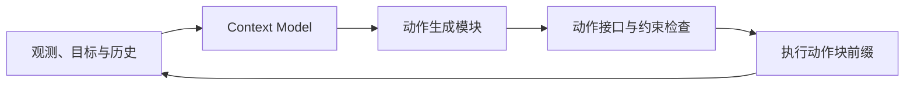

# 进阶篇：机器人怎样构建上下文并生成动作

核心问题：

> 机器人怎样利用当前观测与过去的交互理解任务情境，生成接下来的动作，并在执行后依据新观测继续调整？

基础篇已经规定了视觉、语言、三维目标、本体、触觉和动作的接口。进阶篇把这些接口接成一条随时间运行的数据流：先从多模态历史形成 Context（任务上下文），再根据 Context 生成动作块，经过物理约束检查后只执行一部分。新观测到来时，模型重新构建 Context 并生成下一段动作。此时还没有使用世界模型预测候选动作的后果。

## 本阶段要打通的能力

```text
带时间顺序的多模态观测
→ 找出与当前任务有关的历史
→ 构建可供动作读取的 Context
→ 从示范学习并生成动作块
→ 检查、执行一部分，再读取新观测
```



## 单元一：从当前观测到任务上下文

单元一沿“时间记忆 → 选择性读取 → 多模态组织”递进。第 08 章先说明为什么单帧观测不足以判断运动和接触，再比较 RNN、LSTM 与 GRU 如何保留历史；第 09 章引入 Attention 和 Transformer，让模型直接读取相关时间位置；第 10 章才把视觉、语言、本体与历史动作整理成下游可用的 Context。

| 章节 | 要补上的缺口 |
|---|---|
| [08 时间与记忆](08-time-and-memory.md) | 从[时间序列样本](08-1-temporal-sequences.md)、[RNN](08-2-rnn.md)、[LSTM](08-3-lstm.md)到[GRU 与比较](08-4-gru-and-comparison.md)：过去的信息怎样进入当前预测，简单循环记忆又会遗漏什么？ |
| [09 Attention 与 Transformer](09-attention-and-transformer.md) | 从[注意力计算](09-1-attention-calculation.md)、[位置与 mask](09-2-position-and-masks.md)、[注意力接口](09-3-attention-interfaces.md)到[Transformer 架构](09-4-transformer-architecture.md)：模型怎样找到并读取相关历史，而不只依赖逐步传递的记忆？ |
| [10 多模态 Context Model](10-multimodal-context-model.md) | 从[时间对齐与 token](10-1-time-alignment-and-tokens.md)、[多模态 Context 构建](10-2-multimodal-fusion.md)到[训练与验证](10-3-context-training-and-validation.md)：怎样把不同来源的信息组织成动作模块能够使用的任务上下文？ |

单元一得到的是当前任务的表示，不是动作本身。只有明确哪些观测属于同一时刻、哪些历史仍然有效，下一单元才能根据这份 Context 学习示范动作。

## 单元二：从示范动作到生成式 Action Model

单元二沿“先学会模仿 → 处理多种合理动作 → 接入执行环节”推进。第 11 章先建立示范数据、行为克隆和动作块的基本关系；第 12 章解释 Diffusion 与 Flow Matching 怎样生成连续、多样的动作；第 13 章将不同生成方法统一到动作接口，讨论只执行动作块前缀时的反馈与推理延迟。

| 章节 | 要补上的缺口 |
|---|---|
| [11 从示范到动作序列](11-demonstrations-to-action-sequences.md) | 从[动作标签](11-1-demonstrations-and-action-labels.md)、[行为克隆](11-2-behavior-cloning.md)、[动作块执行](11-3-action-chunk-execution.md)到[多种合理动作](11-4-multimodal-actions.md)：怎样从示范训练第一个动作模型，为什么单值预测可能落在两条可行路线之间？ |
| [12 Diffusion 与 Flow Matching](12-diffusion-and-flow-matching.md) | 从[Diffusion 训练](12-1-diffusion-training.md)、[逐步生成](12-2-diffusion-sampling.md)、[Flow Matching](12-3-flow-matching.md)到[动作约束与评价](12-4-action-generation-in-robotics.md)：怎样在给定 Context 时生成连续动作块，并判断候选是否可用？ |
| [13 生成式 Action Model](13-generative-action-model.md) | 从[模型组成与生成方式](13-1-action-experts.md)、[统一动作接口](13-2-action-interface-and-execution.md)到[推理延迟与动作块衔接](13-3-realtime-action-chunking.md)：不同方法给出的动作怎样恢复物理含义、交给控制器并及时接续？ |

这里的 Context Model 与动作生成模块共同构成 Action Model 的学习部分；安全检查和底层控制器仍有各自职责。第 13 章形成的是“观测—生成—执行—再观测”的闭环，不应把它误认为已经能预见每条候选动作的后果。

## 学完进阶篇应该能解释

- [x] 为什么机器人动作模型需要时间序列，RNN、LSTM、GRU 与 Attention 分别怎样使用历史；
- [x] Transformer 怎样处理位置、mask 与不同模态的信息，Context 为什么不是单纯把所有输入拼在一起；
- [x] 一条示范怎样变成带时间对齐和有效位的动作块训练样本；
- [x] 行为克隆、Diffusion 和 Flow Matching 在训练答案与生成过程上有什么不同；
- [x] 动作生成模块的输出怎样还原为物理动作，为什么生成一整块却只执行一部分；
- [x] 推理延迟、反馈与动作块衔接为什么会改变实际执行结果。

## 配套实践索引

每章配有两份教学 Notebook。建议先读对应小章，再从章节中的实践卡片打开 Colab；课程页面和 Notebook 会保留在不同标签页，便于对照运行结果。实践用于看清数据流和方法边界，不替代真机实验。

| 章节 | 配套实践 | 主要观察内容 |
|---|---|---|
| [08 时间与记忆](08-time-and-memory.md) | 循环记忆；RNN、LSTM 与 GRU 比较 | 对照[08-2](08-2-rnn.md)、[08-3](08-3-lstm.md)和[08-4](08-4-gru-and-comparison.md)，观察早期信息能否影响后续预测 |
| [09 Attention 与 Transformer](09-attention-and-transformer.md) | Attention 与 mask；Transformer 读取历史 | 对照[09-1](09-1-attention-calculation.md)、[09-2](09-2-position-and-masks.md)与[09-4](09-4-transformer-architecture.md)，检查权重、可读位置和输出表示 |
| [10 多模态 Context Model](10-multimodal-context-model.md) | 时间与 token 对齐；任务条件 Context | 对照[10-1](10-1-time-alignment-and-tokens.md)和[10-2](10-2-multimodal-fusion.md)，检查模态与目标改变后模型读取的信息 |
| [11 从示范到动作序列](11-demonstrations-to-action-sequences.md) | 动作块与执行；多种动作模式 | 对照[11-1](11-1-demonstrations-and-action-labels.md)、[11-3](11-3-action-chunk-execution.md)和[11-4](11-4-multimodal-actions.md)，区分训练标签、执行前缀与多峰动作 |
| [12 Diffusion 与 Flow Matching](12-diffusion-and-flow-matching.md) | 条件 Diffusion；条件 Flow Matching | 对照[12-1](12-1-diffusion-training.md)、[12-2](12-2-diffusion-sampling.md)和[12-3](12-3-flow-matching.md)，看训练目标如何用于逐步生成动作 |
| [13 生成式 Action Model](13-generative-action-model.md) | 统一动作接口；动作缓冲与异步执行 | 对照[13-2](13-2-action-interface-and-execution.md)和[13-3](13-3-realtime-action-chunking.md)，检查候选的物理含义、过期结果与执行衔接 |

## 本阶段结束后留下的问题

进阶篇已经能够从历史中构建 Context、生成并滚动执行动作，但生成的候选并没有经过“执行后会发生什么”的预测。同一情境下若有两条都符合动作约束的路线，机器人仍需要回答：

- 给定当前情境和一条候选动作，物体及机器人状态可能怎样变化？
- 如果两条候选都会动，哪一条更接近任务目标，又怎样检查预测是否可靠？
- 未来预测除了用于比较候选，能否与动作生成一起学习？

这些问题从[高级篇的动作条件世界模型](../advanced/index.md)开始展开。
